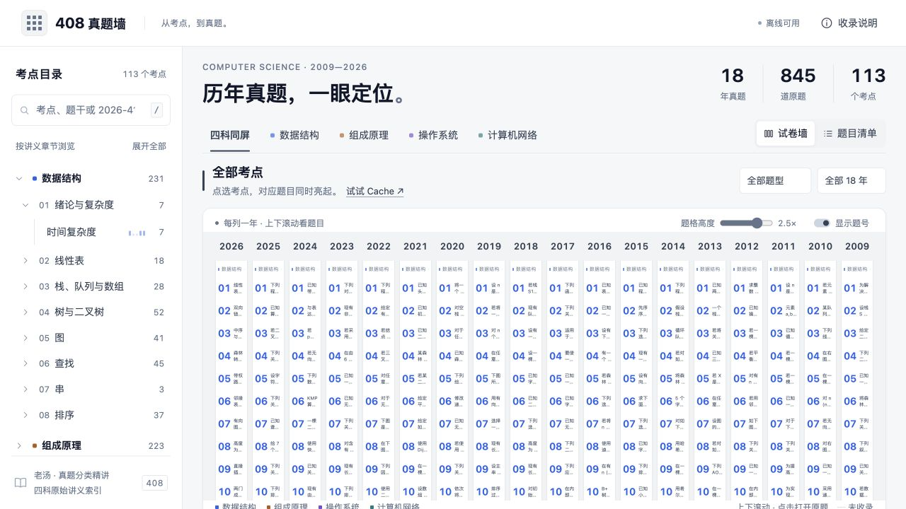
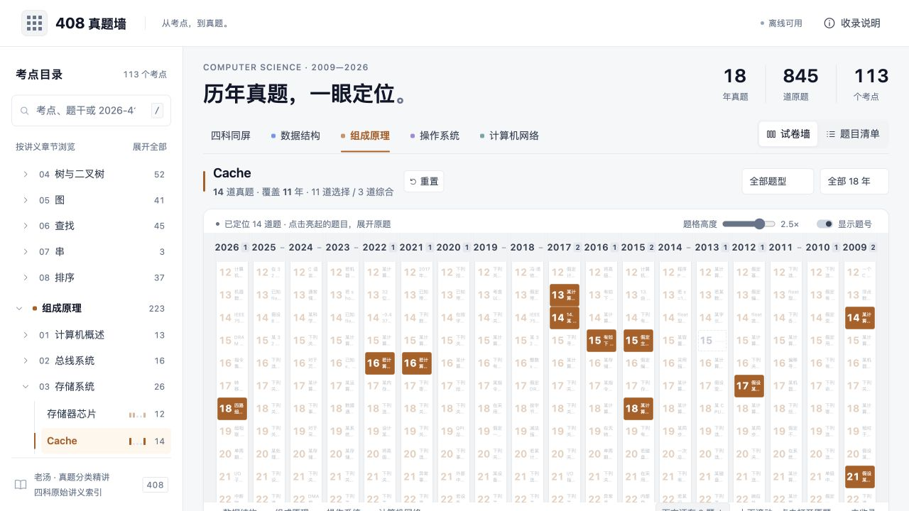
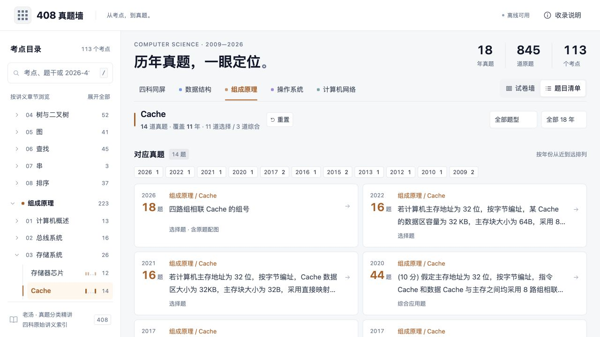
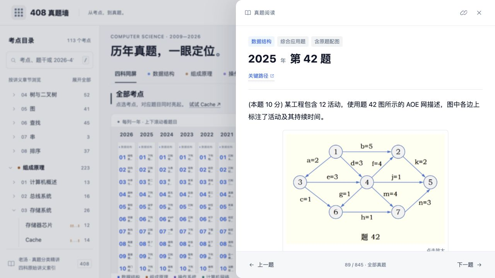

# 408 真题墙

**从考点，到真题。** 将 2009—2026 年的 408 真题放在同一面可交互的试卷墙上：每列一年，每格一道题，点选考点即可同时定位历年的对应题目。

**[打开在线真题墙 →](https://storm-crypto.github.io/408-wall/)** · [备用网站](https://wall-408-kaoyan.copperzebra5.chatgpt.site) · [下载 HTML 离线使用](https://github.com/storm-crypto/408-wall/raw/refs/heads/main/index.html)

覆盖数据结构、计算机组成原理、操作系统、计算机网络四科，当前收录 **18 年 · 845 道独立真题 · 113 个考点**。

总览以跨年份对比为主：桌面保留紧凑的 18 年并排布局，选中考点后，命中题格高亮、其他题目淡化，一眼看出哪些年份考过。界面以浅灰背景、白色卡片和深灰文字为主，四科分别使用蓝、暖橙、紫、青绿作为固定强调色，仅用于科目标识、题号和命中高亮。目录和正文保持清晰的文字对比；点进原题后使用较大字号，代码保留等宽字体与缩进。

## 为什么用真题墙？

- **把跨年份查题变成一次点选。** 复习 Cache、虚拟内存等考点时，不必逐份翻卷；选中考点，各年份的对应题号会同时亮起。
- **保留题目在原卷中的位置。** 年份、原卷题号和科目颜色一起呈现，既能看某个考点的历史分布，也能回到具体题目。
- **方便比较同一考点的不同问法。** 切换到题目清单，可集中阅读题干摘要，再逐题打开，比较条件、设问和关联考点。
- **从整体浏览到原题阅读，操作连续。** 在墙上定位后直接展开题干和配图；阅读时还能跳转关联考点、前置题目或下一题。
- **复习入口容易保存和分享。** 当前考点、筛选条件和题号会保留在网址中，下次打开可以回到同一位置。

## 功能一览

| 功能 | 可以做什么 |
| --- | --- |
| 历年试卷墙 | 四科同屏或按科目筛选；桌面紧凑展示 18 年，按原卷题号高亮匹配题目，悬停预览摘要 |
| 考点目录 | 按科目、章节、考点浏览；显示对应题量，点选后高亮匹配题目 |
| 搜索与组合筛选 | 搜索考点、题干或 `2026-41` 这样的年份题号；筛选选择题、综合应用题及最近 5 年／10 年 |
| 题目清单 | 按年份从近到远展示摘要；点选年份进一步筛选，支持加载更多题目 |
| 原题阅读 | 展开完整题干、代码和原题配图；配图可点击放大，相关题目可跳转 |
| 来源与解析 | 查看题目来源；有讲义配套解析链接的题目可跳转阅读解析 |
| 阅读与定位工具 | 调整题格高度、显示或隐藏题号；复制题目定位链接，按当前筛选连续阅读 |
| 手机与离线使用 | 窄屏可打开考点目录、横向查看年份；下载单个 HTML 文件后可离线浏览题干和图片 |

## 界面预览

以下四张截图均更新于 **2026-10-23**，对应当前版本。

### 选中考点，历年对应题目同时亮起

以 **Cache** 为例，当前收录 14 道题、覆盖 11 年。高亮题格保留年份和原卷题号，方便观察分布并打开原题。

[在线体验 Cache 筛选 →](https://storm-crypto.github.io/408-wall/#subject=co&topic=co-3-50338b3b)

### 切换清单，集中比较题干

同一筛选条件下切换到「题目清单」，可以先浏览题干摘要，再选择需要练习的题目。顶部年份标签支持继续缩小范围。

### 展开原题，保留配图与阅读上下文

下图为 **2025 年第 42 题**：阅读面板展示题干、AOE 网配图、关联考点和上一题／下一题入口。点击配图可放大查看。

[打开示例原题 →](https://storm-crypto.github.io/408-wall/#q=2025-42)

## 怎么用来复习？

1. **学完一个考点：** 在左侧选中考点，查看对应真题；用题型与年份范围控制练习范围。
2. **做同类题比较：** 切换「题目清单」，逐题比较条件与设问，打开原题独立作答。
3. **回查具体题目：** 搜索年份题号，例如 `2026-41`，直接定位。
4. **保存复习入口：** 复制当前网址，或在阅读面板点击链接按钮，保存到笔记中。

快捷键：**/** 聚焦搜索；阅读原题时用 **←／→** 切换上一题／下一题；**Esc** 关闭阅读面板或放大图片。

## 收录范围

题库整理自四份老汤真题分类讲义及 2026 年原卷扫描件，按「年份 + 原卷题号」去重：

| 项目 | 当前数量 |
| --- | ---: |
| 年份 | 2009—2026，共 18 年 |
| 独立真题 | 845 道 |
| 选择题 | 719 道 |
| 综合应用题 | 126 道 |
| 考点 | 113 个 |
| 原题配图资源 | 253 张 |

同一道题可能关联多个考点或科目，因此各分类题量不能直接相加作为独立题目总数。2013 年第 15 题按当前收录规则保留空位，具体说明可在页面「收录说明」中查看。

2026 年题目使用原卷裁图，文字识别用于搜索；讲义配套解析通过外部链接访问，需联网，部分题目没有解析链接。考点分布反映当前收录的历年题目，可用于回顾和选题。

## 离线使用与更新

下载 [index.html](https://github.com/storm-crypto/408-wall/raw/refs/heads/main/index.html)，用浏览器打开即可。题干、配图、样式与交互脚本已包含在单个文件中。文件约 23 MB，在线首次加载需要下载该文件。

本仓库通过 GitHub Pages 发布。更新时替换根目录的 `index.html`，提交并推送到 `main`，网站会自动部署；发布完成后核对 Pages 部署状态与线上页面。界面变更应同步更新本页截图；收录内容变更还应核对统计。
